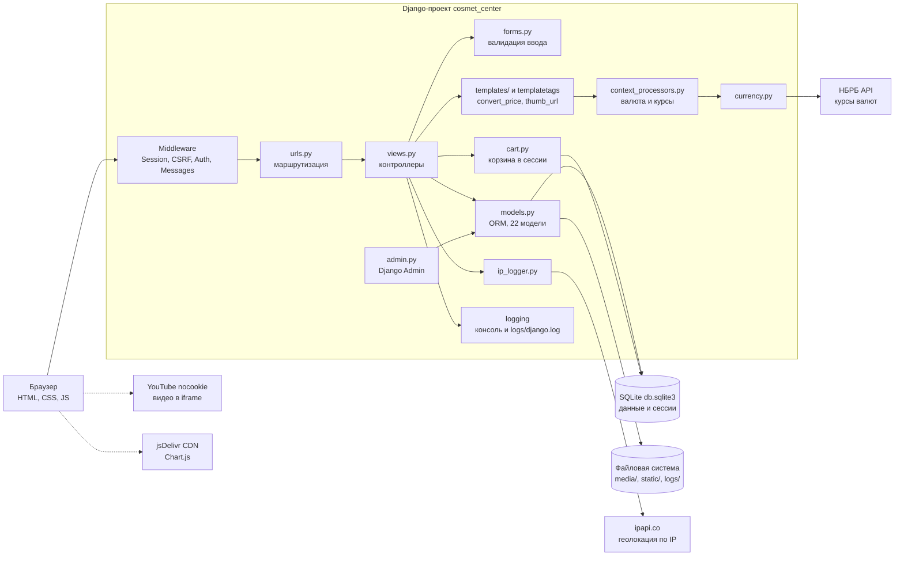

# Косметологический центр (cosmet_center)

Веб-приложение косметологического центра: витрина услуг и врачей, онлайн-запись на приём, корзина и заказ услуг,
личные кабинеты клиента и врача, статистика для администрации.

> Документация проекта: [`docs/requirements.md`](docs/requirements.md) (спецификация требований),
> [`docs/verification.md`](docs/verification.md) (верификация требований),
> [`docs/appointment-lifecycle.md`](docs/appointment-lifecycle.md) (диаграмма состояний записи),
> [`ISSUES.md`](ISSUES.md) (найденные дефекты).

## 1. Назначение и пользователи

**Проблема.** Запись к косметологу, актуальные цены и информация о враче обычно доступны только по телефону;
у администратора нет единой картины записей и выручки.

**Назначение.** Дать клиентам круглосуточный доступ к каталогу услуг и врачей, самостоятельную запись и заказ услуг,
а персоналу — единое место учёта клиентов, записей, оплат и статистики.

| Роль | Кто это | Что делает |
|---|---|---|
| Гость | Любой посетитель сайта | Смотрит каталог, врачей, новости, акции, FAQ; собирает корзину и оформляет заказ; регистрируется |
| Клиент | Пользователь с профилем `Client` (18+) | Записывается на приём, управляет своими записями, оставляет отзывы |
| Врач | Пользователь с профилем `Doctor` | Видит своё расписание и свои записи |
| Администратор | `is_staff` | Ведёт справочники и контент в `/admin/`, смотрит статистику `/statistics/` |

## 2. Стек технологий

| Слой | Технологии |
|---|---|
| Язык | Python 3.12 |
| Фреймворк | Django 4.2 (LTS): ORM, шаблоны, формы, аутентификация, сессии, админ-панель |
| СУБД | SQLite (`db.sqlite3`) — реально используется. В `docker-compose.yml` объявлен PostgreSQL 16, но приложение к нему не подключено (ISS-002) |
| Клиентская часть | Серверные HTML-шаблоны Django, встроенные CSS и немного JS (`fetch` для смены валюты, Chart.js с CDN на странице статистики) |
| Библиотеки | Pillow (изображения), requests (внешние API; не указан в `requirements.txt`, ISS-001), psycopg2-binary (пока не используется) |
| Инфраструктура | Docker, Docker Compose, `manage.py runserver` |
| Тесты | Django `TestCase`: `apps/core/tests.py` и `apps/core/tests_requirements.py` |

## 3. Архитектура

Классическое монолитное приложение Django по схеме MVT (Model–View–Template). Единственное приложение — `apps.core`.



Поток запроса: браузер → middleware (сессия, CSRF, пользователь) → `urls.py` → функция-представление → формы и модели →
шаблон. Контекст-процессор на каждой странице добавляет текущую валюту и курсы.

## 4. Модули

| Модуль | Ответственность |
|---|---|
| `cosmet_center/settings.py`, `urls.py`, `wsgi.py`, `asgi.py` | Конфигурация (БД, шаблоны, логирование, часовой пояс Europe/Minsk, медиа), корневые маршруты (`/admin/` и `apps.core.urls`) |
| `apps/core/models.py` | 22 модели. Каталог: `ServiceCategory`, `Service`, `DoctorCategory`, `Doctor`, `Cabinet`, `Schedule`. Люди: `Client`, `Doctor`. Процессы: `Appointment`, `Sale`, `Order`, `OrderItem`, `Promo`. Контент: `Article`, `FAQ`, `Contact`, `Vacancy`, `Review`, `CompanyInfo`, `CompanyHistoryEvent`, `Certificate`, `Banner`, `Partner`. Валидаторы телефона `+375 (XX) XXX-XX-XX` и возраста 18+ |
| `apps/core/views.py` | Публичные страницы, каталог с фильтрами, корзина и оформление заказа, регистрация и вход, профиль клиента, CRUD записей, кабинет врача, статистика, смена валюты |
| `apps/core/forms.py` | Регистрация клиента, запись на приём, редактирование записи, отзыв, фильтр услуг, оформление заказа (промокод) |
| `apps/core/urls.py` | Маршруты приложения (`path` и `re_path`) |
| `apps/core/cart.py` | Корзина в сессии `{id услуги: количество}`, подсчёт итога |
| `apps/core/currency.py`, `context_processors.py`, `templatetags/custom_tags.py` | Курсы НБРБ с кэшем на 1 час и запасными значениями, выбор валюты, фильтры `convert_price` и `thumb_url` |
| `apps/core/ip_logger.py` | Определение IP клиента и геоинформация через ipapi.co (показывается в профиле) |
| `apps/core/multitasking.py` | Учебная демонстрация потоков, процессов и asyncio, страница `/multitasking/` |
| `apps/core/admin.py` | Регистрация моделей в админ-панели, inline-таблицы расписания, оплат и позиций заказа |
| `apps/core/fixtures/initial_data.json` | Демо-данные: услуги, категории, кабинеты, акции, новости, FAQ, контакты, вакансии |
| `templates/` | 27 HTML-шаблонов на базе `base.html` |
| `apps/core/tests.py`, `tests_requirements.py` | Модульные тесты и тесты верификации требований |

## 5. Точки интеграции

| Что | Как используется | Особенности |
|---|---|---|
| База данных | SQLite `db.sqlite3` через Django ORM; там же таблица сессий | В репозитории лежит файл с уже применёнными миграциями и демо-данными |
| Файловая система | `media/` (фото врачей, баннеры, логотипы, сертификаты, `documents/price_list.pdf`), `static/fonts/BYN.ttf`, `logs/django.log` | `media/` отдаётся Django только при `DEBUG=True` |
| API НБРБ `https://api.nbrb.by/exrates/rates?periodicity=0` | Курсы USD и RUB для пересчёта цен | Таймаут 5 с, кэш 1 час, при ошибке запасные курсы (USD 3.2, RUB 0.035) на 5 минут |
| `https://ipapi.co/<ip>/json/` | Страна, город, провайдер клиента в профиле | Синхронный запрос с таймаутом 6 с, успешный ответ кэшируется на 12 часов, ошибки не кэшируются (ISS-020) |
| YouTube (`youtube-nocookie.com`) | Видео на странице «О компании» | Ссылка из админки преобразуется во встраиваемую |
| jsDelivr CDN | Chart.js на странице статистики | Версия не зафиксирована (ISS-028) |

## 6. Сборка и запуск

### Локально (Windows PowerShell)

```powershell
cd STRWEB\LR1\IGI_lab5
python -m venv .venv
.venv\Scripts\Activate.ps1
pip install -r requirements.txt
pip install requests                 # нет в requirements.txt, см. ISS-001
python manage.py migrate             # пропустите, если используете готовый db.sqlite3
python manage.py loaddata apps/core/fixtures/initial_data.json   # демо-данные (по желанию)
python manage.py createsuperuser     # учётная запись администратора
python manage.py runserver
```

Сайт откроется на <http://127.0.0.1:8000/>, админ-панель — <http://127.0.0.1:8000/admin/>.

Чтобы пользователь стал врачом, в админ-панели в карточке врача укажите поле «Пользователь». Клиентский профиль
создаётся при регистрации на `/register/client/`.

### Docker

```bash
docker compose up --build
```

Приложение будет на порту 8000. Контейнер `db` (PostgreSQL) сейчас приложением не используется (ISS-002).
Docker-сценарий проверен только по файлам: на машине разработки Docker не установлен.

### Тесты

```powershell
python manage.py test apps.core                          # модульные тесты
python manage.py test apps.core.tests_requirements -v 2  # верификация требований
```

Состояние на момент написания документации:
`apps.core.tests` — 57 тестов, из них 2 падают и 1 с ошибкой (ISS-022);
`apps.core.tests_requirements` — 76 тестов, 45 проходят, 31 помечен как известный дефект (`expected failure`).

## 7. Основные маршруты

| Маршрут | Назначение | Доступ |
|---|---|---|
| `/`, `/about/`, `/news/`, `/faq/`, `/contacts/`, `/vacancies/`, `/reviews/`, `/promos/`, `/privacy/` | Информационные страницы | все |
| `/services/`, `/services/<id>/`, `/doctors/`, `/doctors/<id>/` | Каталог услуг и врачей | все |
| `/cart/`, `/checkout/`, `/order/<id>/success/` | Корзина и заказ | все |
| `/register/client/`, `/login/`, `/logout/` | Учётные записи | все |
| `/profile/`, `/appointment/create/`, `/appointment/<id>/edit/`, `/appointment/<id>/delete/`, `/reviews/add/` | Кабинет клиента | клиент |
| `/doctor/profile/` | Кабинет врача | врач |
| `/statistics/`, `/admin/` | Статистика и админ-панель | администратор |
| `/set-currency/` | Смена валюты (POST, JSON) | все |
| `/multitasking/` | Демонстрация многозадачности | все |
