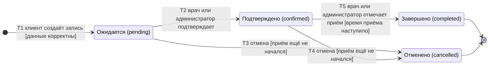

# Жизненный цикл записи на приём (`Appointment`)

Для диаграммы выбрана сущность **«Запись на приём»**. В модели у неё поле `status` с четырьмя значениями:
`pending` (Ожидается), `confirmed` (Подтверждено), `completed` (Завершено), `cancelled` (Отменено).
Диаграмма показывает **требуемый** жизненный цикл (по FR-12…FR-16 из [`requirements.md`](requirements.md)).

## 1. Диаграмма состояний

Начальное состояние — точка входа `[*]`, из которой запись попадает в `pending`.
Конечные состояния — `completed` и `cancelled`: из них переходов нет, запись остаётся в системе только для чтения и учёта.

## 2. Переходы, события и условия

| № | Из | В | Событие | Условие (guard) | Кто выполняет |
|---|---|---|---|---|---|
| T1 | начало | Ожидается | Клиент отправляет форму «Записаться» | Время в будущем; врач и услуга активны; врач оказывает услугу; время внутри расписания врача; нет пересечения с другой записью врача | Клиент |
| T2 | Ожидается | Подтверждено | Подтверждение записи | Запись относится к этому врачу (для врача) | Врач, администратор |
| T3 | Ожидается | Отменено | Отмена записи | Приём ещё не начался | Клиент (свою запись), врач (свою), администратор |
| T4 | Подтверждено | Отменено | Отмена записи | Приём ещё не начался | Клиент (свою запись), врач (свою), администратор |
| T5 | Подтверждено | Завершено | Приём состоялся | Время приёма наступило; после этого администратор фиксирует оплату (`Sale`, одна на запись) | Врач, администратор |

Запрещены: любой переход из конечных состояний, переход `pending → completed` (без подтверждения), изменение статуса клиентом
на `confirmed` и `completed`, отмена завершённой записи и записи с оплатой.

## 3. Как это реализовано сейчас

Сверка с кодом (`apps/core/views.py`, `forms.py`) показала расхождения с диаграммой; они зарегистрированы в [`../ISSUES.md`](../ISSUES.md).

| Переход | Состояние в приложении | Дефект |
|---|---|---|
| T1 | Создаётся запись `pending` и проверяется только «время не в прошлом». Нет проверки услуги врача, расписания, пересечения | ISS-008, ISS-009, ISS-010 |
| T2, T5 | Форма редактирования (`AppointmentUpdateForm`) принимает любой статус от владельца записи, поэтому клиент сам подтверждает и завершает. Врач не может сделать это из кабинета: там нет ссылок на изменение, а после сохранения его перенаправляют в клиентский профиль | ISS-005, ISS-011 |
| T3, T4 | Кнопка «Отменить» физически **удаляет** запись, статус `cancelled` недостижим из интерфейса. Можно удалить даже завершённую запись; вместе с ней каскадно удаляется оплата | ISS-007 |
| Из конечных состояний | Форма позволяет перевести `completed` и `cancelled` обратно в любой статус | ISS-005 |
| Доступ | Пользователь без профиля клиента и врача, а также любой врач (при удалении) могут действовать над чужими записями | ISS-006 |

Фактически приложение допускает переход «любой статус → любой статус» и физическое удаление в любом состоянии.
Автотесты, подтверждающие расхождения: `AppointmentRequirements.test_FR12_*`, `test_FR13_*`, `test_FR14_*`, `test_FR15_*`, `test_FR16_*`.
