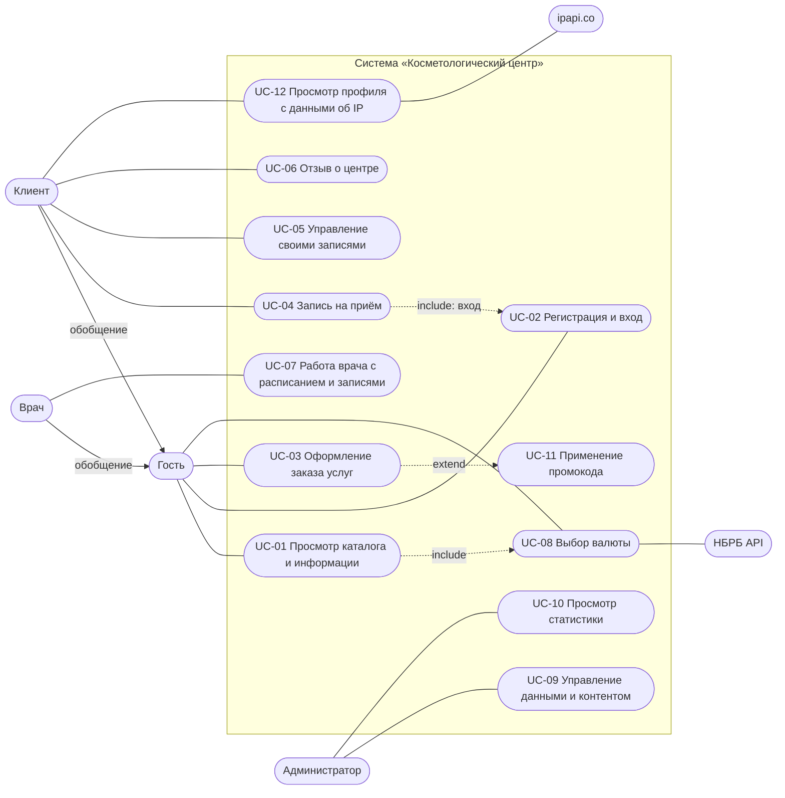

 # Спецификация требований: «Косметологический центр»

Версия 1.0. Проект `cosmet_center` (Django). Как проверялись требования — в [`verification.md`](verification.md).

Требования описывают **желаемое** поведение системы. Они составлены по предметной области и коду проекта, поэтому
часть из них текущей реализацией не выполняется; такие расхождения зарегистрированы в [`../ISSUES.md`](../ISSUES.md).

Обозначения приоритета (MoSCoW): **M** — обязательно, **S** — желательно, **C** — возможно.

## 1. Бизнес-требования

### 1.1 Проблема

Запись к косметологу, цены и сведения о врачах доступны в основном по телефону. Администратор вручную ведёт записи,
не видит загрузку врачей и выручку, а клиент не может записаться вне рабочего времени регистратуры.

### 1.2 Цели

| ID | Цель | Индикатор достижения |
|---|---|---|
| BG-1 | Сделать услуги, цены и врачей общедоступными в сети | Каталог услуг и врачей открыт без регистрации; цены можно смотреть в BYN, USD и RUB |
| BG-2 | Позволить клиенту записываться на приём самостоятельно | Клиент создаёт, смотрит и отменяет запись без участия администратора; двойное бронирование врача невозможно |
| BG-3 | Продавать услуги онлайн | Посетитель оформляет заказ с промокодом без регистрации; сумма и статус заказа соответствуют способу оплаты |
| BG-4 | Дать руководству данные для решений | Администратор видит число записей, популярные услуги, выручку по всем каналам оплаты, статистику цен и возраста клиентов |
| BG-5 | Повысить доверие и узнаваемость центра | Опубликованы сведения о компании, новости, акции, отзывы, FAQ, контакты, вакансии |

### 1.3 Границы

В системе: каталог, запись на приём, заказ услуг, кабинеты клиента и врача, администрирование, статистика.
Вне системы: онлайн-приём платежей (платёжный шлюз), электронная медицинская карта, уведомления по SMS и e-mail,
мобильное приложение.

### 1.4 Заинтересованные стороны

Владелец центра (цели BG-1…BG-5), администратор регистратуры, врачи-косметологи, клиенты, посетители сайта.

### 1.5 Допущения и ограничения

Валюта учёта — белорусский рубль (BYN). Интерфейс на русском языке, часовой пояс Europe/Minsk. Телефоны в формате
`+375 (XX) XXX-XX-XX`. Клиентом может стать только совершеннолетний. Платёжного шлюза нет, поэтому система
не может сама подтвердить оплату картой.

## 2. Пользовательские требования

### 2.1 Актёры

| Актёр | Описание |
|---|---|
| Гость | Неавторизованный посетитель |
| Клиент | Авторизованный пользователь с профилем клиента; обладает всеми возможностями гостя |
| Врач | Авторизованный пользователь с профилем врача; обладает всеми возможностями гостя |
| Администратор | Сотрудник с признаком `is_staff` |
| НБРБ API | Внешняя система, поставляет курсы валют |
| ipapi.co | Внешняя система, определяет местоположение по IP |

### 2.2 Диаграмма вариантов использования

Клиент и Врач наследуют все варианты использования Гостя. Администратор дополнительно имеет доступ к `/admin/`.

### 2.3 Перечень пользовательских требований

| ID | Пользовательское требование | Актёр | Вариант использования |
|---|---|---|---|
| UR-01 | Я как посетитель хочу видеть услуги с ценами, врачей с расписанием, новости, акции, отзывы, FAQ, контакты и сведения о центре, чтобы выбрать центр и услугу | Гость | UC-01 |
| UR-02 | Я как посетитель хочу зарегистрироваться и войти, чтобы пользоваться личным кабинетом | Гость | UC-02 |
| UR-03 | Я как посетитель хочу собрать корзину услуг и оформить заказ, в том числе с промокодом, не создавая учётной записи | Гость | UC-03, UC-11 |
| UR-04 | Я как клиент хочу записаться к выбранному врачу на услугу в свободное время | Клиент | UC-04 |
| UR-05 | Я как клиент хочу видеть свои записи, дописывать примечания и отменять запись | Клиент | UC-05 |
| UR-06 | Я как клиент хочу оставить отзыв о центре | Клиент | UC-06 |
| UR-07 | Я как врач хочу видеть своё расписание и записанных ко мне клиентов и отмечать статус приёма | Врач | UC-07 |
| UR-08 | Я как посетитель хочу смотреть цены в удобной валюте (BYN, USD, RUB) | Гость | UC-08 |
| UR-09 | Я как администратор хочу вести справочники, расписание, акции, новости, заказы и оплаты, а также модерировать отзывы | Администратор | UC-09 |
| UR-10 | Я как администратор хочу видеть сводную статистику центра | Администратор | UC-10 |

### 2.4 Описание ключевых вариантов использования

**UC-04 Запись на приём**

| Поле | Содержание |
|---|---|
| Актёр | Клиент |
| Предусловие | Пользователь вошёл в систему и имеет профиль клиента |
| Основной сценарий | 1. Клиент открывает «Записаться». 2. Выбирает врача, услугу, кабинет, дату и время, пишет примечание. 3. Система проверяет данные. 4. Система создаёт запись в статусе «Ожидается». 5. Клиент видит запись в личном кабинете |
| Альтернативы | 3а. Дата в прошлом: система показывает ошибку, запись не создаётся. 3б. Врач не оказывает услугу, не работает в это время или уже занят: ошибка, запись не создаётся. 1а. Пользователь не вошёл: перенаправление на вход. 1б. Нет профиля клиента: перенаправление на регистрацию |
| Постусловие | Создана запись со статусом `pending`, принадлежащая клиенту |

**UC-03 Оформление заказа услуг**

| Поле | Содержание |
|---|---|
| Актёр | Гость или Клиент |
| Предусловие | В корзине есть хотя бы одна услуга |
| Основной сценарий | 1. Посетитель открывает оформление. 2. Заполняет ФИО, телефон, e-mail, адрес, способ оплаты, при желании промокод. 3. Система проверяет поля и промокод. 4. Система создаёт заказ и позиции с фиксацией цен, очищает корзину. 5. Показывает страницу «Заказ оформлен» |
| Альтернативы | 1а. Корзина пуста: перенаправление в каталог. 3а. Неверный телефон или недействующий промокод: ошибка у поля, заказ не создаётся |
| Постусловие | Создан заказ; статус «Новый» при оплате наличными при визите |

**UC-07 Работа врача**

| Поле | Содержание |
|---|---|
| Актёр | Врач |
| Основной сценарий | 1. Врач открывает «Кабинет врача». 2. Видит расписание по дням недели и список своих записей. 3. Подтверждает запись или отмечает приём завершённым. 4. Возвращается в кабинет врача |

## 3. Функциональные требования

| ID | Требование | Прио­ритет | UR |
|---|---|---|---|
| FR-01 | Главная страница показывает последнюю опубликованную новость, до 6 активных врачей, до 8 активных услуг, активные баннеры и партнёров, сведения о компании. Неактивное и неопубликованное не показывается | M | UR-01 |
| FR-02 | Каталог услуг (`/services/`) показывает только активные услуги и позволяет фильтровать по категории, минимальной и максимальной цене, искать по названию и описанию без учёта регистра, сортировать по цене и названию | M | UR-01 |
| FR-03 | Карточка услуги показывает цену, длительность, врачей, оказывающих услугу, и не более 4 услуг той же категории. Неактивная услуга возвращает 404 | M | UR-01 |
| FR-04 | Список врачей показывает только активных врачей, позволяет искать по ФИО и специализации без учёта регистра и сортировать по ФИО и стажу. Карточка врача показывает расписание. Неактивный врач возвращает 404 | M | UR-01 |
| FR-05 | Корзина хранится в сессии и доступна без входа. Можно добавить активную услугу с количеством (минимум 1; некорректное значение заменяется на 1), изменить количество (0 удаляет позицию), удалить позицию. Итог равен сумме цен позиций, умноженных на количество. Состояние корзины меняется только запросами POST | M | UR-03 |
| FR-06 | Оформление заказа доступно при непустой корзине (иначе перенаправление в каталог). Обязательны ФИО, телефон формата `+375 (XX) XXX-XX-XX`; для вошедшего клиента поля предзаполняются. Система создаёт заказ и позиции с ценой на момент оформления, очищает корзину, перенаправляет на страницу заказа. Страница заказа с персональными данными недоступна посторонним | M | UR-03 |
| FR-07 | Промокод ищется без учёта регистра и принимается, если он существует, активен и сегодняшняя дата в его периоде. Иначе у поля показывается ошибка и заказ не создаётся. К итогу заказа применяется скидка в процентах, результат округляется до копеек | M | UR-03 |
| FR-08 | Заказ с оплатой «Наличные при визите» создаётся в статусе «Новый». Статус «Оплачен» присваивается только после фактической оплаты | M | UR-03 |
| FR-09 | Регистрация создаёт пользователя и клиента (ФИО, дата рождения, телефон, e-mail, адрес необязателен), входит в систему и перенаправляет на главную. Отклоняются: возраст младше 18 лет, неверный формат телефона, несовпадающие пароли, занятое имя пользователя | M | UR-02 |
| FR-10 | Вход по имени пользователя и паролю; при ошибке форма показывает сообщение. После входа система возвращает пользователя на страницу из параметра `next`, иначе на главную. Выход выполняется запросом POST и завершает сессию | M | UR-02 |
| FR-11 | Личный кабинет клиента показывает только записи этого клиента, счётчики «всего», «предстоящие», «завершённые» и контактные данные. Аноним направляется на вход, пользователь без профиля клиента — на главную | M | UR-05 |
| FR-12 | Клиент создаёт запись: врач, услуга, кабинет (необязательно), дата и время, примечание. Запись получает статус «Ожидается». Система отклоняет: время в прошлом, неактивного врача или услугу, врача, не оказывающего выбранную услугу, время вне расписания врача, время, пересекающееся с другой записью этого врача | M | UR-04 |
| FR-13 | Клиент может менять примечание своей записи, но не может сам подтвердить или завершить её. Смену статуса на «Подтверждено» и «Завершено» выполняют врач (для своих записей) и администратор | M | UR-05, UR-07 |
| FR-14 | Отмена записи переводит её в статус «Отменено» и сохраняет в системе. Нельзя отменить завершённую запись и запись, по которой есть оплата | M | UR-05 |
| FR-15 | Разграничение доступа к записям: клиент работает только со своими записями, врач — только с записями к нему, администратор — со всеми. Пользователь без профиля клиента, врача и без признака `is_staff` не может изменять и отменять чужие записи | M | UR-05, UR-07 |
| FR-16 | Кабинет врача показывает расписание врача и только его записи. Подтверждение и завершение приёма выполняется из этого кабинета, после сохранения врач возвращается в кабинет | M | UR-07 |
| FR-17 | Список отзывов показывает только одобренные. Оставить отзыв (оценка 1–5 и текст) может только вошедший клиент. Новый отзыв публикуется после одобрения администратором | S | UR-06 |
| FR-18 | Информационные разделы: «О компании» (описание, история, сертификаты, видео YouTube во встраиваемом виде), новости (только опубликованные; неопубликованная новость возвращает 404), FAQ, контакты, вакансии (только открытые), акции (действующие и архивные), политика конфиденциальности | M | UR-01 |
| FR-19 | Пользователь выбирает валюту BYN, USD или RUB; выбор хранится в сессии, цены пересчитываются по курсам НБРБ. Неизвестная валюта и запрос не методом POST возвращают ответ 400 | S | UR-08 |
| FR-20 | Страница статистики доступна только администратору и показывает: число записей (всего, завершённых, предстоящих), 5 самых востребованных услуг, выручку (оплаты по записям плюс оплаченные заказы), среднее, медиану и моду цен, средний и медианный возраст клиентов, диаграмму числа услуг по категориям | S | UR-10 |
| FR-21 | Администратор через `/admin/` создаёт, изменяет и удаляет все сущности системы. Заказы показывают позиции, врач — расписание, запись — оплату | M | UR-09 |
| FR-22 | Профиль клиента показывает IP-адрес и, если сервис ipapi.co доступен, страну, город, регион и провайдера. При недоступности сервиса страница отображается без этих данных | C | UR-05 |
| FR-23 | Данные клиентов и врачей проверяются на уровне модели: телефон в формате `+375 (XX) XXX-XX-XX`, возраст не менее 18 лет — в том числе при вводе через админ-панель | M | UR-09 |
| FR-24 | Расписание врача: время окончания позже времени начала. Оплата (`Sale`) связана ровно с одной записью | M | UR-09 |
| FR-25 | Страница `/multitasking/` демонстрирует работу потоков, процессов и asyncio: 5 потоков через семафор, подсчёт слов в 4 процессах, 10 асинхронных поисков | C | — |

## 4. Нефункциональные требования

| ID | Категория | Требование | Прио­ритет |
|---|---|---|---|
| NFR-01 | Производительность | Серверное время ответа публичных страниц (`/`, `/services/`, `/doctors/`, `/news/`, `/faq/`) при тестовом наполнении и без обращений к внешним сервисам: 95-й процентиль не более 1 с | M |
| NFR-02 | Безопасность | Страницы личных кабинетов, записей, статистики и добавления отзыва недоступны анониму (перенаправление на вход). Пароли хранятся только в виде хэша. Все изменяющие запросы защищены CSRF-токеном. Никакой параметр запроса не приводит к перенаправлению на внешний сайт. Изменение состояния корзины возможно только методом POST. Ресурсоёмкие демонстрационные страницы недоступны анониму | M |
| NFR-03 | Безопасность конфигурации | В боевом режиме `DEBUG` выключен, `SECRET_KEY` не хранится в репозитории и не имеет префикса `django-insecure`, `ALLOWED_HOSTS` не равен `['*']` | M |
| NFR-04 | Доступность и удобство | В разметке каждой страницы заданы `lang="ru"` и `meta viewport`; у каждого поля формы есть связанная подпись (`label`, `aria-label` или `title`); у каждого изображения есть атрибут `alt` | S |
| NFR-05 | Развёртывание | Установка зависимостей по `requirements.txt` в чистом окружении и команды `migrate` и `runserver` из README запускают рабочий сайт без ручного добавления пакетов. Все сторонние пакеты, импортируемые кодом и тестами, перечислены в зависимостях. База данных в `docker-compose.yml` совпадает с настроенной в `settings.py`. Начальные данные загружаются командой `loaddata` | M |
| NFR-06 | Отказоустойчивость | При недоступности НБРБ сайт продолжает работать на запасных курсах. При недоступности ipapi.co страница профиля отображается, а повторные обращения не ждут таймаут: ошибка кэшируется | M |
| NFR-07 | Локализация | Язык интерфейса — русский (`ru-ru`), часовой пояс Europe/Minsk, валюта по умолчанию — BYN | M |
| NFR-08 | Сопровождаемость | Регистрация клиента, создание, изменение и отмена записи, оформление заказа записываются в журнал (консоль и `logs/django.log`); записи журнала форматируются без ошибок. Автоматические тесты проекта проходят в чистом окружении | S |
| NFR-09 | Целостность данных | Денежные суммы хранятся в `Decimal` с двумя знаками. Цена позиции заказа не меняется при последующем изменении цены услуги | M |

## 5. Трассируемость пользовательских требований к функциональным

| UR | FR |
|---|---|
| UR-01 | FR-01, FR-02, FR-03, FR-04, FR-18 |
| UR-02 | FR-09, FR-10 |
| UR-03 | FR-05, FR-06, FR-07, FR-08 |
| UR-04 | FR-12 |
| UR-05 | FR-11, FR-13, FR-14, FR-15, FR-22 |
| UR-06 | FR-17 |
| UR-07 | FR-13, FR-15, FR-16 |
| UR-08 | FR-19 |
| UR-09 | FR-21, FR-23, FR-24 |
| UR-10 | FR-20 |
