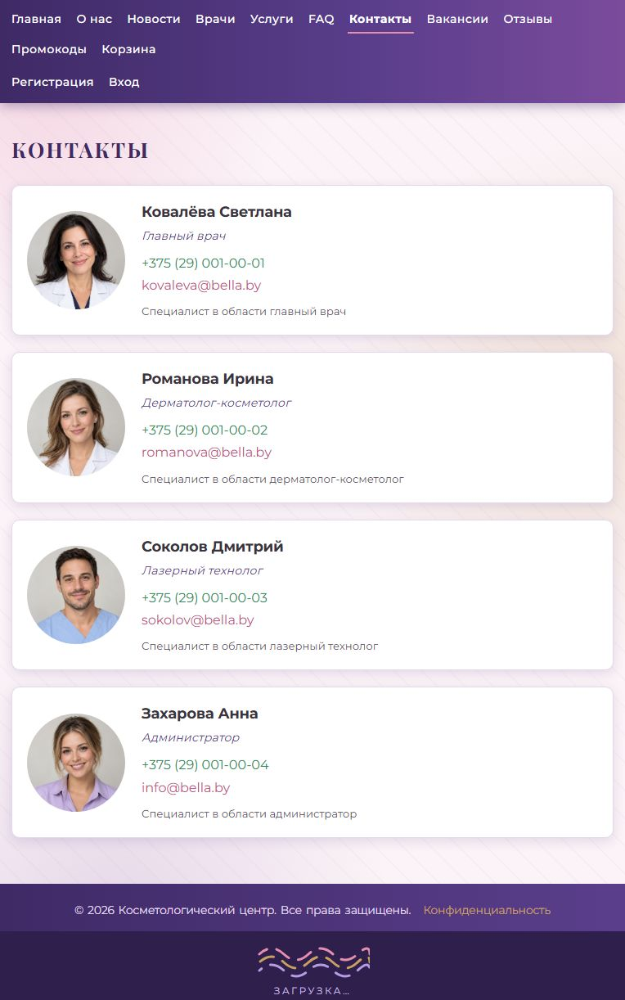

# Проверка лабораторной работы 2

Дата: 25 октября 2026 года.

Проект: `D:\LabWorks\StRweb\IGI_LR1\STRWEB\LR2\IGI_lab5`.

Сверка выполнена по документу «LR2 СТРВП 2024.docx». Вариант — косметологический центр. Требования CSS реализованы; найденные пропуски в содержимом и ошибки локальной работы исправлены. Развёртывание Docker и подготовка к публичному серверу не проверены запуском и имеют два известных расхождения, описанных ниже.

## Результаты проверки

- Django: `manage.py check` — без замечаний.
- Миграции: `manage.py makemigrations --check --dry-run` — изменений нет.
- Полный набор: **133 теста, 131 успешный, 2 ожидаемых падения**, неожиданных ошибок и падений нет. Последний полный прогон — 148 секунд.
- Проверены 43 публичные страницы и страницы отдельных новостей, услуг и врачей: все вернули HTTP 200.
- Все локальные изображения, стили, постеры и встроенные файлы, найденные в разметке этих страниц, существуют.
- В браузере проверены главная, новости, переход к полной статье, контакты, сертификат, FAQ и переключение валюты.
- При ширине 390 px основные страницы не выходят за горизонтальные границы окна.
- При размере 1280 × 520 навигация остаётся `sticky`, высота анимации уменьшается до 300 px.
- При ширине 1280 px полная статья имеет две колонки.

## Сверка требований

| Требование | Реализация |
|---|---|
| Без библиотек оформления | Собственные `style.css`, `pages.css`, `animation.css`; Bootstrap не подключён |
| Селекторы элементов, классов, атрибутов и комбинации | `style.css`: селекторы `^=`, `$=`, `=`, классы, потомки и дочерние элементы |
| Состояния ссылок и фокус | `:link`, `:visited`, `:hover`, `:active`, `:focus`, `:focus-visible` |
| Первый, последний, n-й элементы | Списки, карточки, история и таблицы |
| Состояния форм | `:enabled`, `:disabled`, `:required`, `:out-of-range`, `:checked`; в отзывах есть флажок и радиокнопки |
| Кавычки по языку | Страница «О компании», `q:lang(...)` |
| Псевдоэлементы | Буквица и первая строка статьи, `::before`, `::after`, Unicode-маркеры и `::selection` |
| Шрифты и типографика | Google Fonts, запасные семейства, кернинг, капитель, интервалы, красная строка, переносы |
| Фон и медиазапросы | Градиенты, фоновый узор, запросы по ширине и высоте |
| Каталог через Grid | Карточки услуг на главной и на странице каталога |
| Партнёры и последняя статья | Круглые блоки с границей и тенью; последняя статья использует позиционирование |
| Закреплённая навигация | `position: sticky`, в том числе на низком экране |
| Страница компании | Трансформация логотипа, история по годам, реквизиты и оформление медиа |
| Сертификат | HTML/CSS, граница из SVG-файла с префиксами, фон, градиент, слои, шрифты и выравнивание |
| Семь новостей | 7 опубликованных статей с заголовками, кратким содержанием, изображениями и ссылкой на полный текст |
| Обрезка анонсов и колонки | `overflow`, `text-overflow: ellipsis`, две колонки на широком экране |
| FAQ | Вопросы с датами, раскрытие через `details` / `summary` |
| Контакты | Фото, должность, описание, телефон и почта; размещение через Flexbox |
| Конфиденциальность | Отдельное оформление страницы |
| Вакансии | Плавающие блоки `float` и очистка `clear` |
| Отзывы | Системные ключевые слова шрифтов, состояния полей, флажок и оценка радиокнопками |
| Промокоды | Раздельные оформленные списки действующих и архивных кодов |
| Таблицы | Схлопнутые границы, фон пустых ячеек, caption сверху, выравнивание, стили строк и столбцов |
| Анимация варианта | Лицо, кисточка, последовательное появление цветных черт и названия компании |
| Прелоадер варианта | Анимированные линии внизу страницы; без JS для управления прелоадером |

## Что исправлено

1. Добавлены четыре недостающие статьи, иллюстрации ко всем семи и текст вместо коротких заглушек.
2. Добавлены демонстрационные портреты четырёх сотрудников. Старые изображения с инициалами не удовлетворяли требованию фотографий.
3. Добавлен учебный промокод `WELCOME10`: скидка 10%, срок действия — год с даты проверки. Исходные истёкшие коды сохранены в архиве.
4. Каталог на странице услуг дополнен карточками CSS Grid. Существующая таблица сохранена для требований к таблицам.
5. Исправлены переполнение сетки новостей, размеры сертификата, отображение таблиц на узком экране и перекрывавшийся медиазапрос высоты анимации.
6. Навигация остаётся закреплённой и на низких экранах.
7. Оформление заказа с промокодом больше не вызывает ошибку смешивания `Decimal` и `float`; расчёт округляется до копеек.
8. Наличный заказ получает статус «Новый». Заказ и его позиции создаются в транзакции. Подтверждение заказа доступно владельцу или создавшей его сессии.
9. Изменения корзины требуют POST; переход после добавления защищён от перенаправления на чужой сайт.
10. Переключатель валюты сохраняет выбранное значение и отправляет CSRF-токен. В браузере проверен переход BYN → USD с пересчётом цен.
11. После авторизации сохраняется безопасный переход на исходно запрошенную страницу; показаны ошибки неверного входа.
12. Проверяются активность врача и услуги, связь врача с услугой, расписание и пересечение приёмов врача/кабинета.
13. Исправлен доступ к чужим записям. Клиент редактирует примечания, а подтверждение и завершение относятся к врачу/администратору.
14. Отмена сохраняет запись со статусом `cancelled`; завершённые и оплаченные приёмы не удаляются вместе с оплатами.
15. Врач после изменения возвращается в свой кабинет. Ресурсоёмкая демонстрация многозадачности доступна администратору.
16. Новые отзывы отправляются на модерацию; при ошибке сохраняется введённый текст и показываются ошибки формы.
17. Поиск учитывает регистр кириллицы независимо от ограничений SQLite.
18. Исправлены форматирование записей журнала, кэширование ошибок IP-сервиса, учёт оплаченных заказов в выручке и валидация интервала расписания.
19. `requests` добавлен в зависимости. Из теста возраста убрана лишняя зависимость `python-dateutil`.
20. Для исправленных дефектов сняты пометки ожидаемого падения в существующих тестах. Старые CRUD-проверки приведены к правилам доступа и сохранения отменённых записей.

## Два оставшихся расхождения развёртывания

Они отмечены существующими тестами как ожидаемые падения и не скрыты:

- **ISS-019:** настройки предназначены для локальной лабораторной: `DEBUG=True`, ключ в исходниках, `ALLOWED_HOSTS=['*']`. Проверка готовности к публичному серверу не проходит.
- **ISS-002:** Docker Compose объявляет PostgreSQL, а Django использует SQLite. Запуск контейнерной связки PostgreSQL не подтверждён.

Таким образом, результат относится к локальному запуску лабораторной. Успешный общий статус тестов с двумя expected failures не означает готовность к публичному развёртыванию. Внешние видео и служба шрифтов также зависят от доступности соответствующих сайтов.

## Запуск и восстановление учебного наполнения

Из папки проекта:

```powershell
.\.venv\Scripts\python.exe manage.py runserver
```

Проверки:

```powershell
.\.venv\Scripts\python.exe manage.py check
.\.venv\Scripts\python.exe manage.py test
```

Дополнения для ЛР2 сохранены в `apps/core/fixtures/lr2_content.json`. Для новой пустой учебной базы сначала загружается `initial_data.json`, затем `lr2_content.json`. Повторная загрузка фикстур в существующую базу перезаписывает записи с совпадающими идентификаторами.

Перед изменениями создана резервная копия исходников, стилей, шаблонов и `db.sqlite3`:
`C:\Users\Bahemaal\Documents\Codex\2026-10-25\new-chat-2\work\backup`.

## Демонстрационные изображения

Портреты вымышленных сотрудников созданы встроенным инструментом imagegen. Файл проекта: `D:\LabWorks\StRweb\IGI_LR1\STRWEB\LR2\IGI_lab5\media\contacts\lr2-team.png`. Квадранты общего атласа отображаются отдельно с помощью CSS, исходное изображение не редактировалось.

Промпт:

> Use case: photorealistic-natural. Asset type: ONE portrait atlas image for a fictional cosmetology center student demo website. Create one square image divided into exactly four equal square portrait panels in a seamless 2 by 2 grid, no gutters, no borders, no text. Top left: friendly woman physician about 45 in white coat, dark hair. Top right: woman dermatologist about 35, light brown hair, white coat. Bottom left: male technician about 35 with short dark hair, pale blue scrubs. Bottom right: woman receptionist about 28 with dark blond hair wearing a lilac blouse. All four people are entirely fictional adults. Each portrait is a realistic professional head and shoulders photograph with face centered in its quadrant and plenty of margin around head, matching soft studio lighting, clean pale warm gray background. Natural skin texture, welcoming expressions. Each quadrant must work independently as a square staff photo. No logos or words.


